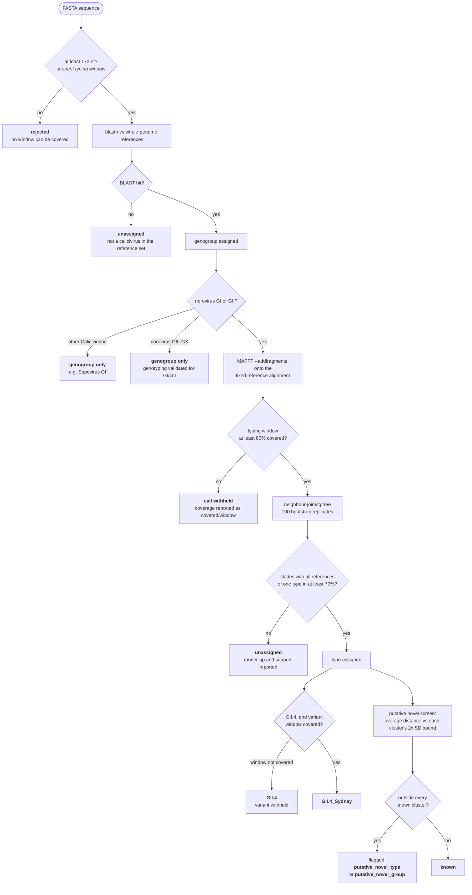
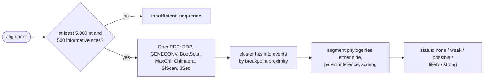

# CaliciTyper benchmarking report

How CaliciTyper has been tested, what each result does and does not show, and
how to reproduce every number. Read the caveats: several of these are easy to
misread as stronger evidence than they are.

Version 0.6.1, reference set doi:10.5281/zenodo.24161236. Sections with no
data yet are marked as such rather than filled with estimates.

Reproduction commands and the data behind every table are in the benchmark
dataset on Zenodo; `## Reproducing` at the end gives the short version.

---

---

# What the tool does to a sequence

Every gate below can stop a call. The point of the chart is that a result of
`unassigned` or `genogroup only` is a *decision*, not a failure, and the output
says which gate produced it.



ORF1 and ORF2 run through this independently, which is what dual typing means:
a recombinant carries a different type in each, and either can be withheld
while the other is called.

`calicityper recomb` is a separate path and does not use the reference sets at
all — it scans an alignment the user supplies:



---

# Caliciviridae genogroup assignment

Genogroup detection is a BLAST search against whole genomes, so unlike
genotyping it needs no curated alignment and covers every calicivirus in the
test set, including the ones that must be *rejected* as non-norovirus.

Scored against the RIVM Norovirus Typing Tool's own lineage calls for 5,986
GenBank accessions (job 1125735/1138052):

| Scope | n | Both assigned | Agreement | Precision | Recall | **F1** |
|---|---|---|---|---|---|---|
| All caliciviruses | 5,887 | 5,871 | 98.06% | 98.06 | 97.79 | **97.92** |
| Norovirus only | 4,295 | 4,294 | 98.35% | 98.35 | 98.32 | **98.34** |

Composition of the 5,986 records: 4,295 norovirus (3,771 GII, 339 GI, 100 GV,
51 GIV, 29 GIII, 5 GVII) and 1,691 non-norovirus *Caliciviridae* — 765
Lagovirus, ~420 Sapovirus, ~190 Vesivirus and ~320 other or unassigned. The
non-noroviruses are the part that tests rejection.

CaliciTyper assigns a genogroup to every record RIVM does (0 cases where RIVM
assigns and it does not). The 16 disagreements are lineage-level differences,
not failures to call.

---

## Norovirus

### Genotype assignment

**Against RIVM.** 4,295 records RIVM calls norovirus (job 1138052):

| Region | n | Both assigned | Agreement where both assign | Precision | Recall | **F1** |
|---|---|---|---|---|---|---|
| ORF2 capsid | 4,092 | 3,956 | **100.00%** | 100.00 | 96.68 | **98.31** |
| ORF1 P-type | 3,822 | 3,763 | **100.00%** | 99.89 | 98.56 | **99.22** |
| GII.4 variant | 1,781 | 1,696 | 97.05% | 95.98 | 93.42 | **94.68** |

Read these together. **Where both tools assign a type they agree completely**
for capsid and P-type. The gap is assignment *rate*: 136 records RIVM types and
CaliciTyper declines for capsid, 55 for P-type. CaliciTyper assigns a capsid
type RIVM declines in **0** cases and a P-type in 4.

That asymmetry is deliberate. Before the typing-window coverage rules, the
counts the other way were 158 and 145 — calls made from sequence that did not
cover the window RIVM types on. Those are now withheld, which is why precision
is 100% and recall is not.

The GII.4 variant row is the weakest and is the known regression: the variant
window coverage floor (80%) is stricter than RIVM's behaviour, which assigns a
variant to 99-100% of its GII.4 records at every sequence length. The floor is
provisional pending the truncation leave-one-out curve.

**Scope.** Genotyping is scored on norovirus only. RIVM's norovirus tool also
emits sapovirus genotypes in nomenclature that collides with norovirus
(`GI.1`, `GII.3`); scoring those against a norovirus typer counted 294
correctly identified sapoviruses as capsid disagreements and dragged the
capsid figure from ~99% to 87.6%.

**Leave-one-out on the bundled references.** Each reference ORF is typed
against all other references of its genogroup; its own label is the answer.
Only types with at least two references can be evaluated.

| Region | Queries | Genogroups | Distinct types | Assigned | Correct | Wrong |
|---|---|---|---|---|---|---|
| ORF2 capsid | 125 | GI (34), GII (91) | 42 | 100% | 100% | 0 |
| ORF1 P-type | 147 | GI (36), GII (111) | 49 | 97.3% | 96.6% | 1 |

GII.4 is resolved to variant level; all 17 evaluable GII.4 references are
called correctly at 81-100% support.

Two caveats that matter:

- **Leave-one-out flatters the tool.** The queries are the same curated,
  full-length references the tool types against. It shows the method is wired
  up correctly; it does not estimate accuracy on real data, and cannot.
- **The one error is a confident error.** `AB074893.1` (true `GII.PNA4`) was
  called `GII.P11` at **100% support**. Bootstrap support is not a guarantee of
  correctness, and no threshold makes it one.

**Reference-set correction (0.6.1).** Two GII RdRp references had their typing
region taken from the wrong CDS of a partial genome: `JX846926` (GII.P8) and
`JX289822` (GII.P1). Their stored rows sat ~0.60 nt from every other reference
including their own type, so no GII.P8 or GII.P1 query could reach bootstrap
support — the clade test needs the query to group with *both* references of a
type. After re-extraction, leave-one-out P-type assignment rose 93.9% → 97.3%
and correct calls 93.2% → 96.6%; on 100 RIVM-typed genomes, five P-type calls
changed, all five to RIVM's answer.

**Sequence requirements.** Three windows decide whether a call is supportable.
Coverage of the *window* is what counts, not the length of the submitted
sequence: a 7 kb genome that misses region C still fails region C.

| Window | Region | Length |
|---|---|---|
| VP1 region C | 5' end of VP1 | 252 nt (GII), 264 (GI), 267 (GI.9), 255 (GIX) |
| RdRp 3' window | 3' end of RdRp | 172 nt (173 for GIV) |
| GII.4 variant window | P2 to the VP1 C-terminus | 789 nt |

Input shorter than 172 nt is rejected outright; a call is withheld below 80%
window coverage. One GII.4 Sydney genome cut three ways:

| Input | Region C | Variant window | Call |
|---|---|---|---|
| region C only (360 nt) | 241/252 | — | `unassigned` (bootstrap 69% < 70%) |
| region C + P2 (1,340 nt) | 241/252 | 508/789 (64%) | `GII.4` — variant withheld |
| complete VP1 (1,690 nt) | 241/252 | 775/789 (98%) | `GII.4_Sydney` |

**Not yet measured:** accuracy on genuinely partial input. Every record in the
RIVM set is at least 2,000 nt (median ~7,400), so it says nothing about
amplicons. That needs references truncated to each window and re-typed — the
truncation leave-one-out harness, which is also what should set the 80% floor.

### Recombination detection

Real norovirus reference genomes cannot serve as negative controls: norovirus
recombines constantly around the ORF1/ORF2 junction, so a published reference
strain frequently *is* a recombinant and a `possible` call on one may be
correct. Specificity is therefore measured against sequences that are
non-recombinant by construction.

Six seeded datasets, run end to end through OpenRDP (job 1139087, one SLURM
task each, ~20-50 min per dataset):

| Dataset | Construction | Expected | Result |
|---|---|---|---|
| `non_recombinant` | query descends from one lineage | `none` or `weak` | ✅ |
| `clear_recombinant` | lineage0 left of 5100, lineage2 right | `possible`+, breakpoint near 5100 | ✅ breakpoint recovered |
| `weak_signal` | 150 nt imported tract | not above `possible` | ✅ |
| `conflicting` | two tracts from different donors | multiple events | ✅ |
| `orf_mismatch_only` | distinct ORF1/ORF2 ancestry, near-identical donors | never `strong` | ✅ returns `insufficient_sequence` |
| `too_short` | 900 nt | `insufficient_sequence` | ✅ refused |

`orf_mismatch_only` returning `insufficient_sequence` with zero events is the
correct answer, not a failure: near-identical donors leave too few informative
sites, and the QC gate refuses rather than guessing.

**Component validation.** Each scoring component was checked against ground
truth separately.

*Coordinate mapping.* Alignment column 3551 maps to query position 3201 for a
breakpoint planted at 3200.

*Segment phylogenies.* The first implementation compared everything left of a
breakpoint against everything right of it. That confirms recombination but
cannot localise it: on a real recombinant almost any split shows donor A
against donor B, so a decoy breakpoint at 1000 scored 1.00, identical to the
true one. Flanking windows (`segment_window`, default 1000) fixed it:

| Breakpoint tested | Score | |
|---|---|---|
| 3551 | 1.00 | true |
| 3400 | 1.00 | 151 nt from true, inside `max_breakpoint_distance` |
| 1000 | 0.00 | decoy |
| 2000 | 0.00 | decoy |
| 6000 | 0.00 | decoy |

*Breakpoint semantics.* Window scanners (MaxChi, Chimaera, BootScan, SiScan)
report the window *containing* a breakpoint, so the estimate is its centre.
GENECONV and 3Seq report a converted *fragment* spanning thousands of columns,
where the breakpoints are the **edges**. Clustering on midpoints alone hid the
true event entirely; span width now decides which rule applies.

*Status rules.* One method plus a phylogeny hint previously reached `possible`
and produced 15 spurious events on a control. A single method now qualifies
only with phylogenetic support >= 0.7 *and* distinct parents.

**What this does not show.** The datasets are generated from random sequence
with a simple substitution model. They test that the machinery localises a
known breakpoint and does not invent one. They do **not** reproduce real
norovirus sequence evolution, and say nothing about performance on partial or
chimeric wastewater contigs.

**Unverified:** reproducibility between identical runs. The test covering it
never ran — it passed a directory it had not created — so whether OpenRDP is
deterministic is still an open question.

### Putative novel genotypes

The screen applies the 2x SD criterion of Chhabra *et al.* 2019 per cluster: a
query is `known` if its average distance to the members of some genotype is
within that genotype's mean + 2 SD, otherwise flagged.

**Leave-one-out**, with every bound recomputed without the reference being
tested:

| Region | Scenario | n | `known` | `putative_novel_type` | `putative_novel_group` |
|---|---|---|---|---|---|
| VP1 | own genotype present | 159 | **149 (94%)** | 10 (6%) | 0 |
| VP1 | own genotype removed | 166 | 9 (5%) | **150 (90%)** | 7 (4%) |
| VP1 | own genogroup removed | 166 | 0 | 136 (82%) | **30 (18%)** |
| RdRp | own P-type present | 163 | **157 (96%)** | 5 (3%) | 1 (1%) |
| RdRp | own P-type removed | 176 | 88 (50%) | **87 (49%)** | 1 (1%) |

Bold is the right answer. The VP1 genotype screen is reliable: 94% specific,
95% sensitive to any flag. The RdRp P-type and VP1 genogroup screens are not
sensitive, and that reflects the data rather than tuning:

- **Partial-RdRp P-types overlap.** Between-P-type distances in the typing
  region go as low as 0.07 nt, inside many P-types' own spread. Chhabra *et al.*
  needed complete ORF1 sequences to confirm their own reclassification of this
  region.
- **VP1 genogroups overlap.** Genogroup diversity varies widely, and GIX was
  classified as GII.15 until 2019.

So a flag from either is meaningful; `known` from either is weak evidence.

**On real sequences.** 100 GenBank genomes from the RIVM set (92 GII, 8 GI),
all assigned established types by RIVM:

| Region | `known` | flagged | `not_assessable` |
|---|---|---|---|
| VP1 | 94 | 0 | 6 |
| RdRp | 72 | 1 | 27 |

The single flag, `AB242258.2`, types GII.P21 at 100% as RIVM does but sits
0.047 nt from the GII.P21 references against a bound of 0.044 — a borderline
call against a very tight cluster, which is the screen's main false-positive
mode.

**A flag is never a designation.** Chhabra *et al.* name a cluster built from a
single sequence, or from one geographic location, "not assigned" (GII.NA1 and
similar). A flag here means one sequence fell outside every known cluster:
worth inspecting, tentative at most.

---

## Sapovirus

### Genotype assignment

**Not implemented — no data.** Sapovirus input is detected to genus and
genogroup and stops there.

Reference sets have been built but are not wired into the typing path:
144 VP1 records covering 51 of 52 genotypes, and 81 RdRp records covering 29 of
45 P-types, all carrying the complete canonical window (VP1 560 aa, RdRp
512 aa). Recovery of complete-window records for the 16 uncovered P-types is in
progress. Groups with no complete reference will report that rather than being
typed to a nearest neighbour.

Zhao *et al.* 2024 define sapovirus genotypes on **nucleotide** distances
(amino acid distances could not separate them statistically), with cutoffs
< 0.161 for the same VP1 genotype, < 0.503 for the same genogroup, < 0.266 for
the same P-type and < 0.531 for the same P-group. Those cutoffs apply only to
complete-region alignments, which is why truncated records are excluded.

### Recombination detection

Working and tested. Sapovirus is a different genome shape: ORF1 encodes the
nonstructural proteins **and** VP1, so the hotspot is the NS7(RdRp)/VP1
junction *inside* ORF1, not a junction between two ORFs.

Three seeded datasets at 7,200 nt, matching complete GenBank records, run end
to end (job 1139087):

| Dataset | Planted breakpoint | Recovered | Supporting methods | Result |
|---|---|---|---|---|
| `sapovirus_non_recombinant` | none | none | — | ✅ |
| `sapovirus_clear_recombinant` | 5139 (RdRp/VP1 junction) | 4949-5415 | bootscan, geneconv, rdp, threeseq | ✅ |
| `sapovirus_mid_ns_recombinant` | 2500 (mid-NS) | 2301-2541 | bootscan, geneconv, threeseq | ✅ |

A fourth test confirms the event is labelled an **RdRp-VP1 junction** rather
than an ORF1-ORF2 junction. Both genome models score nt 5139 as a hotspot, but
only the sapovirus model names it correctly — running sapovirus through the
norovirus model would give a plausible score with a biologically wrong label.

**What this does not show.** As for norovirus, these are synthetic alignments
from random sequence. No real sapovirus recombinant has been tested.

### Putative novel genotypes

**Not implemented — no data.** The screen needs reference sets to measure
distances against, so it is blocked behind sapovirus genotype assignment.

The published cutoffs above would be the bounds; unlike norovirus, Zhao *et al.*
also publish a pairwise distance range per genotype, which will allow an
independent check that computed within-cluster distances fall inside the
published ranges.

---

---

# Runtime

Not organism-specific: the same code paths type a sapovirus genogroup as a
norovirus genotype.

Job 1126022, sonic92, 16 cores, BLAS pinned, GII-dominated input from the
RIVM benchmark set:

| Sequences | 1 thread | 4 threads | 16 threads |
|---|---|---|---|
| 1 | 2.5 s | 3.4 s | 3.4 s |
| 4 | 4.2 s | 3.9 s | 4.0 s |
| 96 | 36.2 s (0.38 s/seq) | 15.7 s (0.16 s/seq) | 10.7 s (0.11 s/seq) |
| 5,986 | — | — | 5 m 45 s (0.058 s/seq) |

Threads do nothing below ~4 sequences: process startup dominates. Genogroup
drives cost more than library size — the bootstrap is ~95% of runtime and
scales with the square of a genogroup's reference count, so GII (121 ORF1
references) is far slower per sequence than GI (41).

BLAS threads are pinned inside the package since 0.6.0. Unpinned, each worker's
NumPy started a pool per core and they fought: measured at **62.9x slower**
with byte-identical calls (1,823 s versus 29 s for 100 sequences on 16 cores).

`calicityper recomb` is in a different class: OpenRDP over a 7.2-7.5 kb
alignment of nine sequences measured at **20-50 minutes per alignment** (job
1139087). That is why the end-to-end recombination tests are marked `slow` and
deselected by default.

---

## Reproducing

```bash
conda env create -f environment.yml && conda activate calicityper
calicityper setup                                  # reference set, verified
pytest tests/ -v                                   # unit, CLI and regression
python tests/loo_validation.py --threads 8         # genotype leave-one-out
python tests/putative_novel_validation.py          # novel-type leave-one-out
pytest -m slow tests/test_recomb.py                # recombination, needs OpenRDP
python scripts/benchmark_runtime.py --out results/runtime.tsv
```

The RIVM comparison needs RIVM's own calls for the accession list:

```bash
python scripts/fetch_rivm_test_set.py rivm_all.fasta --all   # 5,986 records
calicityper type rivm_all.fasta -o all_typed.tsv --threads 16
python scripts/validate_vs_rivm.py all_typed.tsv
```

The accession list, RIVM's calls, CaliciTyper's calls and the per-record
discordance files are in the benchmark dataset on Zenodo
(doi:10.5281/zenodo.24161236).

The synthetic recombination datasets are seeded and regenerated by the test
suite, so a failure is reproducible; they are also deposited alongside the
benchmark data.

## Attribution

The comparison is scored against output from the
[RIVM Norovirus Typing Tool](https://www.rivm.nl/mpf/typingtool/norovirus/)
(Kroneman *et al.* 2011, *J Clin Virol* 51:121-125), obtained via the original
norovirus genotyping implementation by Yang Ji (diploma student, University
College Dublin). Classification follows Chhabra *et al.* 2019 (*J Gen Virol*
100:1393) for norovirus and Zhao *et al.* 2024 (*BMC Genomics* 25:1131) for
sapovirus.
